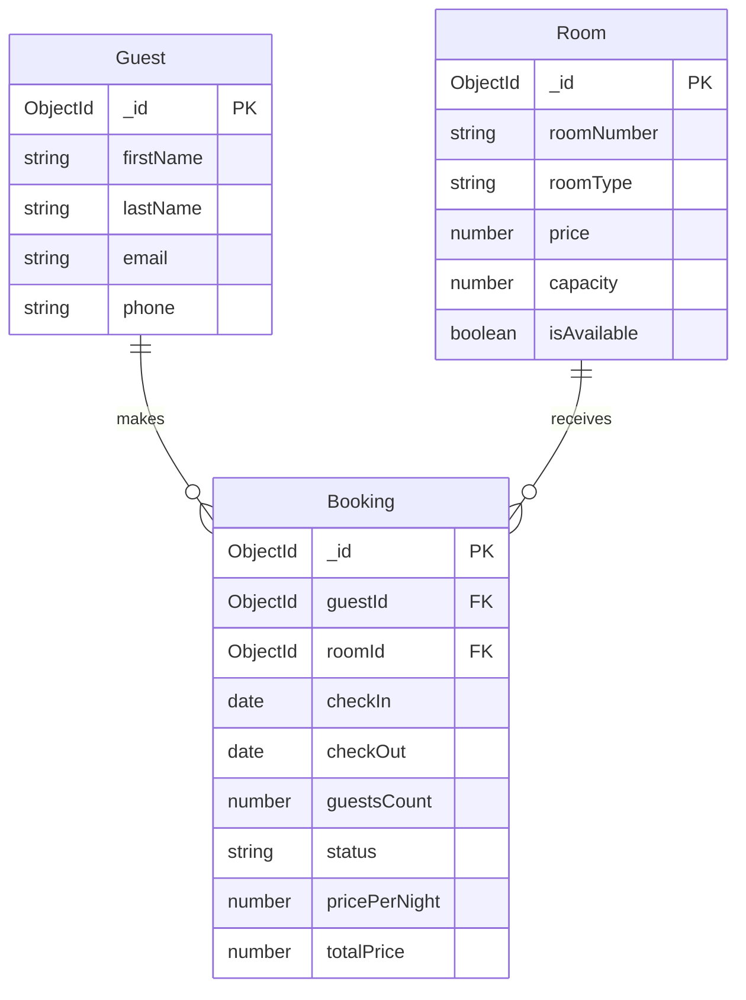

# Booking Module — Database & Domain Design

**Document:** `src/docs/booking-db-design.md`  
**Module:** Booking Domain & Data Layer  
**Status:** Draft — Pending Review

---

## Overview

This document defines the database schema, entity relationships, domain constraints, indexing strategy, and core business rules for the **Booking Module** within the Hotel Management System.

It establishes the data model and documents the key design decisions before implementing the booking API endpoints.

## 1. Core Entities & Relationships

The Booking domain connects guests with physical hotel rooms over specific date intervals.



### Relationship Rules

- **Guest → Booking:** A guest can have multiple bookings, while each booking belongs to one guest.
- **Room → Booking:** A physical room can have multiple bookings over time, while each booking is assigned to one room.
- **Room-specific booking:** The system assigns a specific physical room when creating a booking.
- **Guest creation:** If the guest does not exist, they can be created through the Guest API before creating the booking.

## 2. Access Patterns & Query Optimization

Database indexes are selected according to the application's expected read and write patterns.

| Access Pattern | Target Entity | Proposed Index / Strategy | Purpose |
|---|---|---|---|
| Room availability and booking overlap checks | Booking | `{ roomId: 1, status: 1, checkIn: 1, checkOut: 1 }` | Helps identify conflicting bookings for a specific room and date range. |
| Guest booking history | Booking | `{ guestId: 1 }` | Retrieves bookings associated with a particular guest. |
| Room booking history | Booking | `{ roomId: 1 }` | Retrieves reservations associated with a physical room. |
| Today's check-ins | Booking | `{ status: 1, checkIn: 1 }` | Supports front-desk queries for confirmed bookings scheduled to check in. |
| Today's check-outs | Booking | `{ status: 1, checkOut: 1 }` | Supports room turnover queries for guests scheduled to check out. |
| Financial reports | Booking | `{ createdAt: 1 }` | Supports queries over booking creation dates for reporting and analytics. |

**Indexing note:** These indexes are proposed based on expected query patterns. Their effectiveness should be validated against actual MongoDB queries and execution plans. Compound index field order and date-range predicates must be considered carefully, particularly for overlap checks.

## 3. Domain Constraints & Validation Matrix

Data integrity is enforced at multiple layers to ensure that invalid bookings cannot be created through the API or persisted in the database.

| Business Rule | Joi Validation | Service Layer | Mongoose / Database Layer |
|---|---|---|---|
| Check-out must be after check-in | Validates `checkOut > checkIn` | Revalidates the date interval before creation | Schema-level date validation where appropriate |
| Valid guest count | Requires an integer with a minimum of `1` | Ensures guest count does not exceed room capacity | `min: 1` and integer validation |
| No overlapping bookings | Not applicable to basic input validation | Queries for conflicting active bookings | Indexes optimize queries but do not independently prevent overlapping bookings |
| Valid booking status | Restricts values to `BOOKING_STATUS` | Enforces permitted status transitions | Schema `enum` validation |

### Booking Overlap Rule

Two bookings for the same room overlap when:

```js
existingBooking.checkIn < requestedCheckOut &&
existingBooking.checkOut > requestedCheckIn
```

The overlap query must also exclude booking statuses that no longer block room availability, such as cancelled bookings.

**Important:** Preventing double bookings requires more than an index. Concurrent booking requests must be handled safely through an appropriate transaction or concurrency-control strategy.

## 4. Architectural & Design Decisions

### 4.1 Room-Specific vs. Room-Type Booking

**Decision:** Room-specific booking.

**Rationale:** Each booking references a physical room through `roomId`. This provides precise room allocation and inventory tracking, which fits the current project scope.

The trade-off is reduced flexibility compared with assigning a room only when the guest arrives.

### 4.2 Price Snapshot Pattern

**Decision:** Store `pricePerNight` and `totalPrice` in the Booking document.

**Rationale:** Booking prices should remain historically accurate even when the room's current price changes.

The booking records the agreed price at creation time rather than relying on the room's current price when retrieving historical bookings.

### 4.3 Date Storage Format

**Decision:** Store `checkIn` and `checkOut` as native JavaScript `Date` values, persisted as BSON Date values in MongoDB.

**Rationale:** Native dates support reliable comparisons, sorting, and date-range queries.

The application must define a consistent hotel-local date policy and timezone-handling strategy. UTC normalization should not be applied blindly if bookings represent calendar dates in the hotel's local timezone.

### 4.4 Reference vs. Embedding

**Decision:** Use ObjectId references through `guestId` and `roomId`.

**Rationale:** Guests and rooms are independently managed entities. References reduce duplication and allow guest and room information to be maintained separately.

The booking retains its own price snapshot so that changes to the Room document do not alter historical booking prices.

## 5. Core Booking Rules

The Booking service must enforce the following rules before persisting a new booking:

1. The referenced guest must exist.
2. The referenced room must exist.
3. `checkOut` must be later than `checkIn`.
4. `guestsCount` must be a positive integer and must not exceed the room's capacity.
5. The requested room must not have a conflicting booking during the requested date interval.
6. The initial booking status is `confirmed` after successful availability validation.
7. The booking must preserve the agreed room price at the time of creation.

### Availability and Concurrency

The availability check uses a half-open date interval: `[checkIn, checkOut)`.

This means a guest can check out on the same date another guest checks in, provided the hotel permits same-day room turnover.

The service must also account for concurrent requests. Two requests must not both successfully reserve the same room for overlapping dates simply because both availability checks completed before either booking was saved.

## 6. Scope and Review Notes

This document describes the proposed database and domain design. It does not represent a guarantee that every constraint has already been implemented.

The following items should be verified during implementation and review:

- The exact `BOOKING_STATUS` values and which statuses block availability.
- The timezone policy for check-in and check-out dates.
- The concurrency-control strategy used to prevent double booking.
- The final index definitions based on actual query patterns.
- Whether financial reports use booking creation dates, stay dates, or both.

**Review status:** Pending mentor review before finalizing the Booking API contract.
